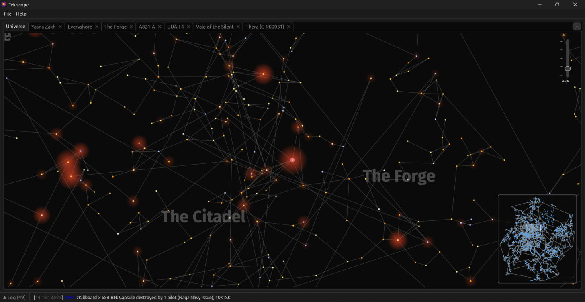
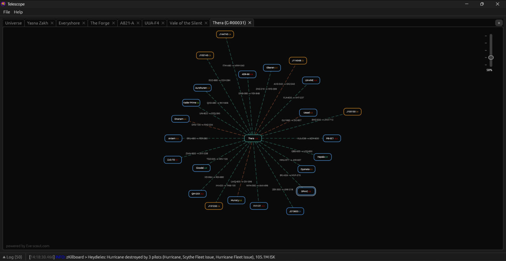
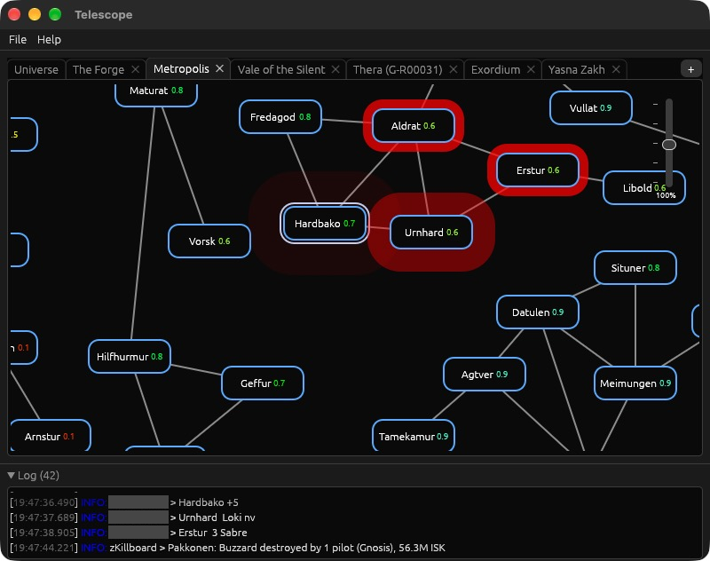
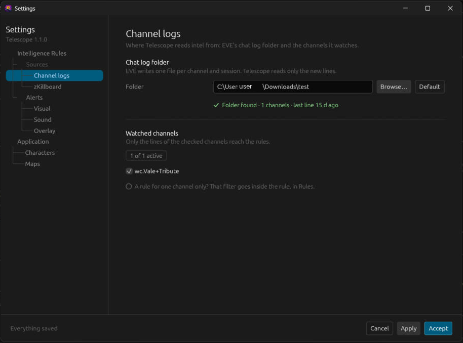
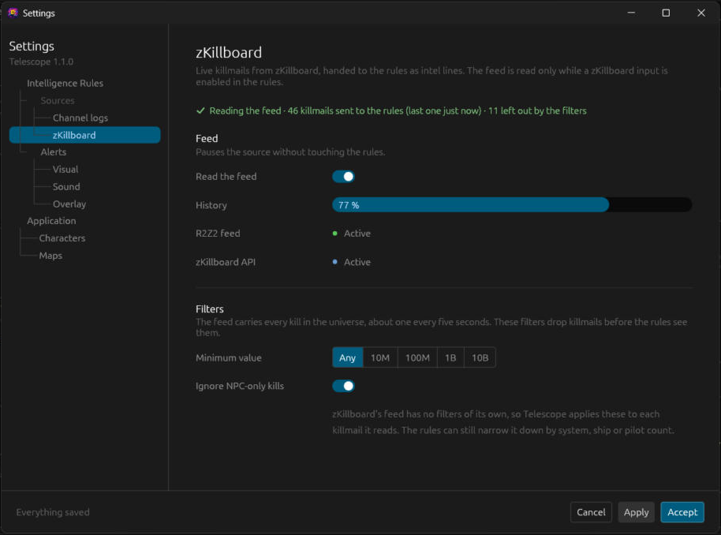
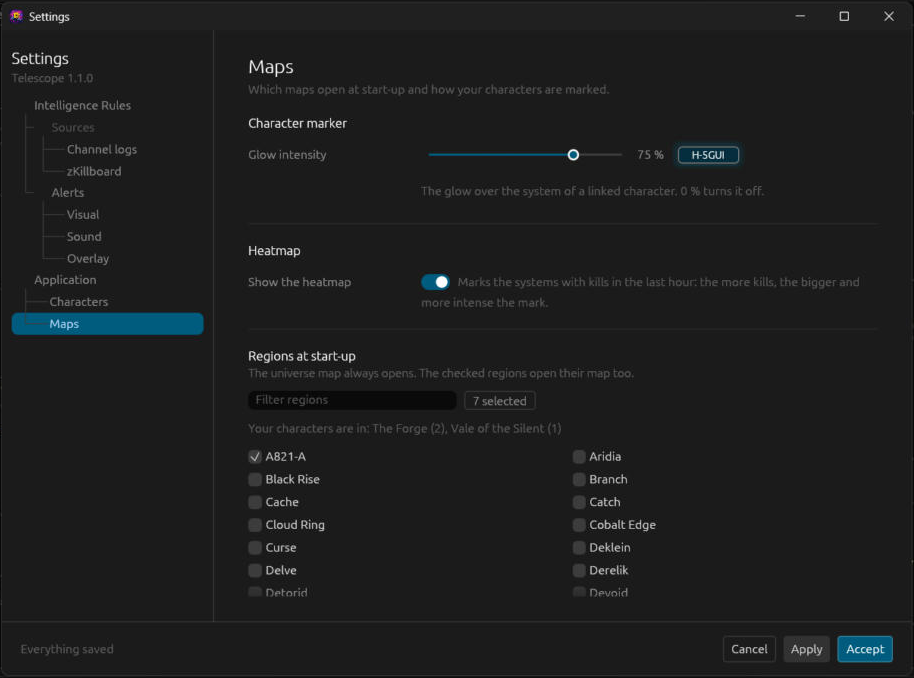
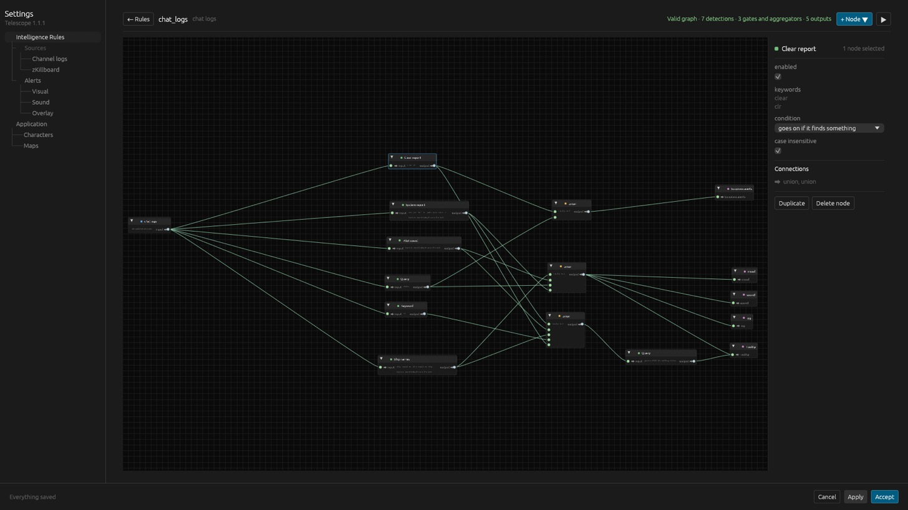
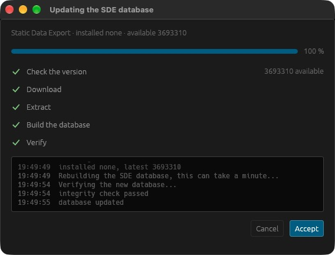
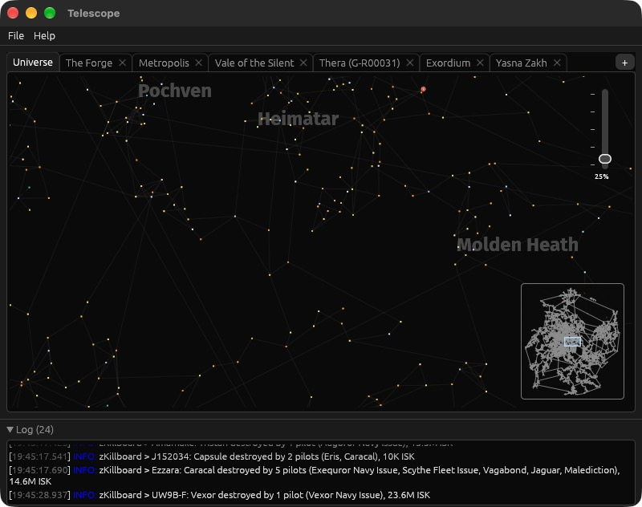

# Telescope

[](https://github.com/rafaga/telescope/actions/workflows/ci.yml)
[](https://github.com/rafaga/telescope/actions/workflows/security.yml)
[](https://discord.gg/v9SseaWhz4)

Telescope is a desktop application that watches your EVE Online chat logs,
evaluates them against configurable pattern rules and shows the resulting
alerts on interactive maps of New Eden. Characters linked through EVE SSO are
followed through ESI so the maps can show where they are and warn about
nearby threats. It is similar to other intel gathering tools, but with some
key differences.

* Designed to be multiplatform (Windows, macOS and Linux).
* Designed to be as easy to use as possible.
* Designed with privacy in mind. Your data resides in your computer.

## Features

* **Intel watching** — monitors the EVE chat log directory and parses new
  lines as they are written, recognising the channel from the log file name.
* **Intel rules** — a node graph edited in *Settings -> Rules*: inputs
  (chat logs or the live zKillboard killmail feed), detections (systems, ships, pilot counts, keywords, custom
  regexes or word lists), logic nodes (unions, formatters) and
  outputs (map alert, sound, log, tooltip, suppress). Stored in the local
  database; the whole graph can be exported to or imported from
  `rules.toml`.
* **Interactive maps** — the universe map and one map per region, each region a
  tab you choose in *Settings -> Maps*. Nodes write the security status of the
  system (or its class, `C1` to `C6`, in wormhole space), and their tooltips
  carry the region and the killmails of the last hour and day. Alerts pulse on
  the nodes, linked characters glow, and an optional heat map marks the
  systems with the most kills.
* **zKillboard** — the live R2Z2 feed is an intel source of its own. The
  default rules turn each killmail into a tooltip line, a log entry, a map
  alert and a sound when it happens within the alert radius, and
  *Settings -> zKillboard* pauses the feed and filters it by value and
  NPC-only kills. What it learns is kept in a local cache, so a restart does
  not ask zKillboard or ESI again for what is still good.
* **Thera and Turnur wormholes** — with EvE-Scout on (the default; `[eve_scout]
  enabled` in `telescope.toml`), region maps draw the wormholes of Thera and
  Turnur next to the systems they leave from, with their signatures. Thera has
  a map of its own (*Thera (G-R00031)*), and on the universe map every system
  with a wormhole to Thera or Turnur gets a small circle joined by a dashed line.
  A hub with many wormholes (Turnur) is folded into one node, *WH Turnur*, on
  busy regions such as Metropolis (Settings -> Maps -> Wormholes); its tooltip
  counts them by kind of system and a click opens the map of Yasna Zakh. The
  data comes from [eve-scout.com](https://www.eve-scout.com).
* **Overlay** — an optional semi-transparent panel over the EVE window that
  lists the events near your characters, newest or closest first, colored by
  distance (*Settings -> Alerts -> Overlay*).
* **Alerts you can hear** — a rule's *sound* output plays an alarm clip you
  choose, and map nodes list the ships and pilot counts of each report in
  their tooltip. The work runs on its own threads, so an alarm is not delayed
  by a hidden or stalled window.
* **Character linking via EVE SSO** — authorizes through ESI and keeps
  linked characters, their corporations and alliances in a local database.
  The database, tokens included, is encrypted with SQLCipher and keyed from
  your machine's identifier.
* **Location tracking** — a background watchdog polls ESI for each linked
  character's location and moves their marker on the maps.
* **Automatic SDE updates** — the CCP Static Data Export database is checked,
  downloaded and built automatically the first time Telescope runs, and it
  keeps itself up to date. A progress window shows what it is doing.
* **Settings with a draft** — every change stays a draft until *Apply* /
  *Accept*; *Cancel* puts everything back, the interface language included.
* **Log file** — what Telescope reports is also written to
  `logs/telescope.<date>.log`, one file a day, the last seven kept.
* **Languages** — the interface is available in English and Spanish, and
  follows your operating system's language by default.

Platforms tested by hand:

* MacOS Tahoe (ARM64)
* Windows 11 (ARM64)
* Windows 11 (Intel x86-64)

CI builds and tests every change on Linux, Windows and macOS.

## Screenshots

| | |
|---|---|
|  |  |
| **Universe map.** Every region you choose opens as a tab; kills glow as a heat map. | **Thera.** Its own map, with the wormholes EvE-Scout reports and its credit in the corner. |
|  |  |
| **Region map.** The nodes an intel line reports pulse, and the line lands in the status log. | **Channel logs.** The chat log folder, its channels and when each last spoke. |
|  |  |
| **zKillboard.** The live feed, how much of the last hour it has read, and its filters. | **Maps.** Character glow, heat map and the regions that open at start-up. |
|  |  |
| **Rules.** The graph of detections, logic and outputs, with the selected node's fields. | **SDE database.** Built automatically the first time Telescope runs. |

Telescope running on macOS (Apple Silicon):



## Community

Questions, ideas, bug reports and rule sets to share are welcome on the
[Discord server](https://discord.gg/v9SseaWhz4). Bugs and feature requests are
also tracked as [GitHub issues](https://github.com/rafaga/telescope/issues).

## Building and running

```sh
cargo run --release
```

You do not need to provide the SDE database yourself, Telescope builds it on
first run. You do need your own ESI application
from CCP, whose client id is given to the build as the `ESI_CLIENT_ID`
environment variable (no secret key is needed: the login uses PKCE) — see
[BUILD.md](BUILD.md) for the full requirements, ESI setup, tests, logging and
profiling instructions.

## Documentation

* [ARCHITECTURE.md](ARCHITECTURE.md) — a map of the code: the workspace's
  crates, the `telescope` crate's modules, threads and messages, and the main
  flows (chat log to alert, linking a character, location tracking, SDE
  updates), illustrated with diagrams.
* [BUILD.md](BUILD.md) — requirements, ESI credentials, building, tests and
  coverage, the CI workflows (`check.sh` runs them locally), logging and Tracy
  profiling.
* [CHANGELOG.md](CHANGELOG.md) — notable changes, following
  [Keep a Changelog](https://keepachangelog.com/en/1.1.0/).
* The crates of the workspace: [`webb`](crates/webb/README.md) (intel rule
  engine and EVE back end), [`egui-panels`](crates/egui-panels/README.md)
  (settings screen components),
  [`native_tools`](crates/native_tools/README.md) (native dialogs and machine
  identification), `eve-scout` (client of the EvE-Scout API) and `zkill`
  (requests to zKillboard under its rate limits).

## Credits

Wormhole data of Thera and Turnur comes from
[EvE-Scout](https://www.eve-scout.com), and killmails from
[zKillboard](https://zkillboard.com). EVE Online and its static data belong to
CCP Games.

## License

MIT, see [LICENSE.md](LICENSE.md).
